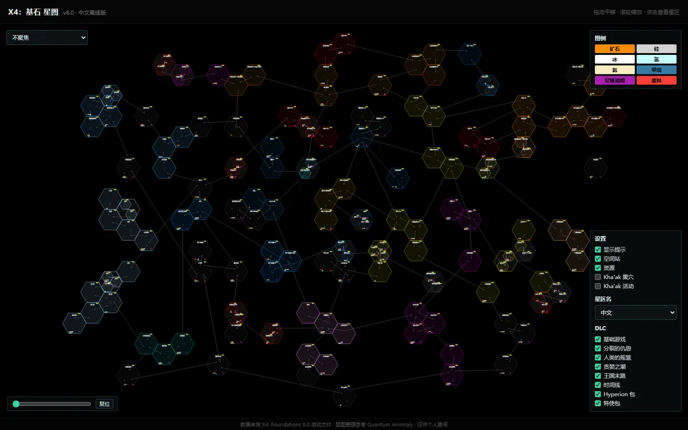

# X4：基石 星图（中文）

X4: Foundations 银河星图的静态中文版，纯前端，离线可用。



## 功能

- 拖动平移，滚轮以光标为中心缩放
- 悬停星区：所属势力、日照、八种资源产出、Kha'ak 活动
- 点击图例资源，在地图上叠加丰度分布（四档明暗，形状区分资源）
- 按星门跳数聚焦，高亮可达范围
- 图层与 DLC 过滤
- 星区名可切换纯中文 / 游戏原文「英文｜中文」

## 使用

```bash
npm install
npm run dev
```

构建 `npm run build`；单文件离线版 `npm run build:single`，产物双击即可打开。

## 数据

星区、星门、资源数据来自 Quantum Anomaly 的接口快照；中文名解析自 X4 游戏文本，重建脚本见 `tools/`。

## 说明

非官方同人作品，X4 相关素材版权归 Egosoft GmbH 所有。
